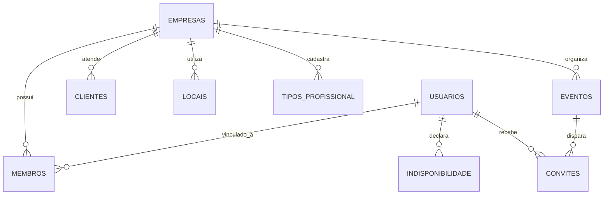
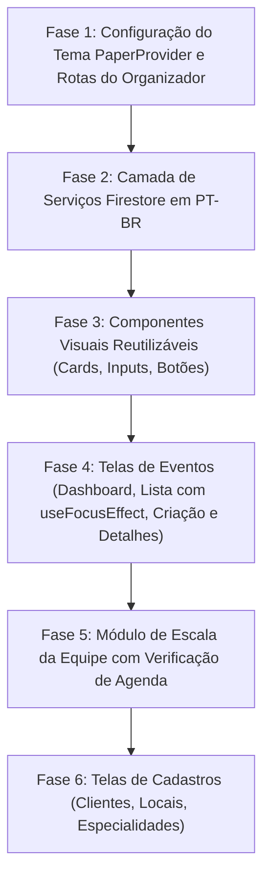

# Plano de Implementação: Front-End do Organizador — Celebra

Este plano detalha a arquitetura, telas, fluxo de navegação e componentes para a construção do **módulo do Organizador (Administrador)** no aplicativo **Celebra**. 

A proposta conecta diretamente as **diretrizes e padrões ensinados nas aulas da faculdade**, os **códigos práticos do repositório de aulas** (`DesenvolvimentoMobile`), as **22 telas reais exportadas do Figma** e a **documentação oficial de regras de negócio e banco de dados** ([`modelo-banco-e-regras-celebra.md`](file:///c:/Users/User/Documents/GitHub/Celebra/docs/modelo-banco-e-regras-celebra.md)).

---

## 1. Alinhamento com os Conceitos e Exemplos do Repositório de Aulas

Conforme analisado no repositório `C:\Users\User\Documents\GitHub\DesenvolvimentoMobile` e nos slides de aula:

| Conceito da Aula | Aplicação no Módulo Organizador | Padrão no Repositório de Aulas (`DesenvolvimentoMobile`) |
|---|---|---|
| **Arquitetura & Estrutura de Pastas** *(Aula 1)* | Seguiremos o padrão `src/`: <br>• `components/`: botões, cards, headers, seletores com `react-native-paper`.<br>• `views/organizador/` (ou `screens/organizer/`): telas dedicadas ao organizador.<br>• `services/`: chamadas assíncronas ao Firestore e regras de negócio.<br>• `theme/`: tema React Native Paper com `MD3LightTheme` customizado.<br>• `assets/`: paleta oficial do Figma. | Espelha a organização de `src/components/`, `src/views/` e `assets/colors.json`. |
| **Componentização Limpa** *(Aula 2)* | • Componentes funcionais puros com desestruturação de props (`CardComponent.js`).<br>• Uso de `children` e props opcionais com defaults (`button = "Detalhes"`).<br>• Renderização condicional limpa (`{!!condicao && ...}`). | Mesma estrutura de `src/components/CardComponent.js` estendida para o design do Celebra. |
| **Hooks e Ciclo de Vida** *(Aula 2)* | • `useState`: controle de formulários com spread operator (`setForm(prev => ({ ...prev, [campo]: valor }))`).<br>• `useEffect`: inicialização.<br>• `useFocusEffect`: recarga automática das listagens ao focar na aba/tela. | Aplicação direta de `useFocusEffect(useCallback(() => { ... }, []))` como em `Home.js`. |
| **UI com React Native Paper** *(Aulas 1 e 2)* | Envolvimento no `PaperProvider`, uso de `Appbar.Header`, `Appbar.Content`, `Card`, `Button` (`mode="contained"`), `List.Item`, `List.Icon`, `Switch` e `Text variant="..."`. | Idêntico aos exemplos de `App.js`, `Home.js` e `Movies.js`. |
| **Navegação em Abas e Pilha** *(Aula 3)* | • `createBottomTabNavigator` (`@react-navigation/bottom-tabs`) para as 4 abas do Organizador.<br>• `createStackNavigator` / `createNativeStackNavigator` para telas modais e detalhes.<br>• Navegação com `navigation.navigate('NomeTela', { params })`. | Baseado diretamente na estrutura do `App.aulaAnterior.js`. |
| **Persistência & Dados** *(Aula 4)* | • **AsyncStorage**: cache de sessão ativa e preferências (`@chave:dado`).<br>• **Cloud Firestore**: integração assíncrona seguindo a modelagem de coleções raiz em português. | Segue os métodos de gravação/leitura de `AsyncStorage` vistos no `App.js`. |
| **Expo SDK 57 & Nova Arquitetura** *(Regra do Projeto)* | Adoção das APIs modernas do Expo SDK 57 (sem dependências legadas ou descontinuadas). | Compatível com React 19.2 e Expo 57 já presentes no `package.json`. |

---

## 2. Regras de Negócio e Modelo de Dados (PT-BR)

O organizador é o administrador da produtora. Baseado em [`modelo-banco-e-regras-celebra.md`](file:///c:/Users/User/Documents/GitHub/Celebra/docs/modelo-banco-e-regras-celebra.md), o front-end orquestrará as seguintes coleções de primeiro nível:



---

## 3. Arquitetura de Navegação do Organizador (Fiel ao Figma)

A navegação do Organizador no Figma possui **4 abas inferiores principais** e sub-navegação por abas superiores (*Top Tabs*):

```
NavigationContainer
│
├── AuthStack (Não autenticado)
│   ├── Login
│   └── Cadastro
│
└── OrganizadorStack (Autenticado - papel "administrador")
    │
    ├── OrganizadorTabs (Bottom Tab Navigator - idêntico ao Figma)
    │   ├── Tab 1: "Início" (Dashboard operacional: métricas, alertas e próximos 15 dias)
    │   ├── Tab 2: "Eventos" (Lista completa, busca, filtros "Futuros" / "Concluídos" e cards com status de equipe)
    │   ├── Tab 3: "Administrando" (Top Tabs: Tipos de Evento | Tipos de Profissional | Tipos de Local | Locais | Clientes)
    │   └── Tab 4: "Perfil" (Minha Empresa: dados cadastrais, relatórios, notificações com switch e logout)
    │
    └── Telas em Pilha e Modais (Stack Navigator)
        ├── TelaAdicionarEvento (Abas superiores: Geral | Locais | Equipe | Financeiro)
        ├── TelaDetalhesEvento (Abas superiores: Geral | Locais | Equipe | Financeiro)
        ├── ModalAdicionarProfissional (Tipo de profissional, seleção de técnico, switch "Enviar convite para o app?")
        ├── ModalCadastroCliente (Nome, CPF, Instagram, Telefone)
        ├── ModalCadastroLocal (Nome, endereço, tipo de local, observações)
        └── ModaisCadastroTipos (Modais rápidos para Tipo de Evento, Tipo de Profissional e Tipo de Local)
```

---

## 4. Detalhamento Fiel das Telas do Organizador (Baseado nas Imagens do Figma)

### 4.1. Aba Início — Dashboard (`TelaInicioOrganizador`)
- **Header Escuro**: Saudação ("Olá, Organizador!"), nome da produtora (ex: "Bella Produzione Vídeos"), data formatada ("Seg, 12 out") e ícone de notificações.
- **Cards de Métricas Rápidas**:
  - `12` Eventos cadastrados (com indicador visual verde).
  - `3` Nos próximos 15 dias.
- **Card de Atenção**: "Eventos pendentes de finalização" com badge de contagem e atalho "Visualizar eventos pendentes →".
- **Próximos 15 dias**:
  - Card destaque com foto de capa, badges "Casamento" e "Em 5 dias", título "Ana & Pedro", data, horário e local ("Sítio Romagna").
  - Lista resumida dos eventos subsequentes ("18 out · 15 anos da Luiza", "19 out · Formatura Medicina").

### 4.2. Aba Eventos — Gerenciamento (`TelaListaEventosOrganizador`)
- **Botão Destaque Amarelo Superior**: `+ Adicionar Evento`.
- **Barra de Pesquisa**: Campo com ícone de lupa ("Buscar evento ou protagonista") e ícone de filtro.
- **Filtros por Pílulas**: "Futuros" (selecionado em Navy escuro) e "Concluídos".
- **Cards de Evento Ricos**:
  - Foto de capa com badge flutuante ("Casamento", "15 Anos", "Formatura").
  - Título e subtítulo (nomes dos protagonistas/clientes).
  - Grade de metadados com ícones: Data (`17 out`), Horário (`16h`), Locais (`2 locais`) e Convidados (`180`).
  - Barra de equipe no rodapé do card: Ícone de câmera, contagem (ex: `2/3 atribuídos`) e badge de status (`Equipe Pendente` em amarelo ou `Equipe Completa` em verde claro).

### 4.3. Aba Administrando — Cadastros da Empresa (`TelaAdministrando`)
- **Header Escuro**: "Minha empresa" / "Administrando seu negócio".
- **Abas Superiores Deslizáveis (Top Tabs)**:
  1. `Tipos de evento`
  2. `Tipos de Profissional`
  3. `Tipos de Local`
  4. `Locais`
  5. `Clientes`
- Cada aba contém:
  - Título e descrição do contexto.
  - Campo de busca com botão "Buscar".
  - Botão amarelo de ação rápida (ex: `+ Adicionar cliente`, `+ Adicionar local`).
  - Lista de itens cadastrados com dados de contato/detalhes e botão de lápis (editar).

### 4.4. Aba Perfil — Minha Empresa (`TelaPerfilOrganizador`)
- **Card Principal da Empresa**: Avatar com iniciais em círculo Navy ("BP"), Razão/Fantasia ("Bella Produzione Vídeos"), slogan, CNPJ, e-mail comercial, cidade e botão "Editar dados da empresa".
- **Relatórios Rápidos**: Total de eventos ativos e item "Relatório de Eventos · Exportar PDF".
- **Notificações com Switch do React Native Paper**:
  - "Eventos e equipe · Pendências e eventos"
  - "Pagamentos de clientes · Lembretes de vencimentos"
- **Configurações**: "Acessos e permissões", "Segurança da conta" e botão destacado vermelho "Sair da conta".

### 4.5. Fluxo de Criação e Detalhes de Evento (`TelaFormEvento` & `TelaDetalheEvento`)
- Organizados em 4 sub-abas:
  1. **Geral**: Seleção de cliente, tipo de evento, notas de produção, duração e observações.
  2. **Locais**: Seleção do local/endereço, tipo de local, horários de início e fim e observações de montagem.
  3. **Equipe**: Lista de profissionais de campo atribuídos (cargo, nome do profissional, status verde `Confirmado(a)` ou amarelo `Pendente`, ícones de editar e excluir) e botão amarelo `+ Adicionar profissional de campo`.
  4. **Financeiro**: Valor total, quantidade de parcelas, status de cada parcela (paga/a vencer) e botão `+ Adicionar pagamento ao evento`.

### 4.6. Modais do Sistema
- **Modal Adicionar Profissional de Campo**: Seletor de Tipo de Profissional, Seletor de Profissional, Switch "Enviar convite para o aplicativo?", alerta informativo e botão "Salvar e enviar convite".
- **Modal Cadastro Cliente**: Campos estilizados com ícones (Nome, CPF, Instagram, Telefone), botões "Salvar" e "Cancelar".
- **Modais de Tipos e Locais**: Formulários limpos e objetivos para criação rápida sem sair do fluxo.

---

## 5. Roteiro de Implementação Sugerido


